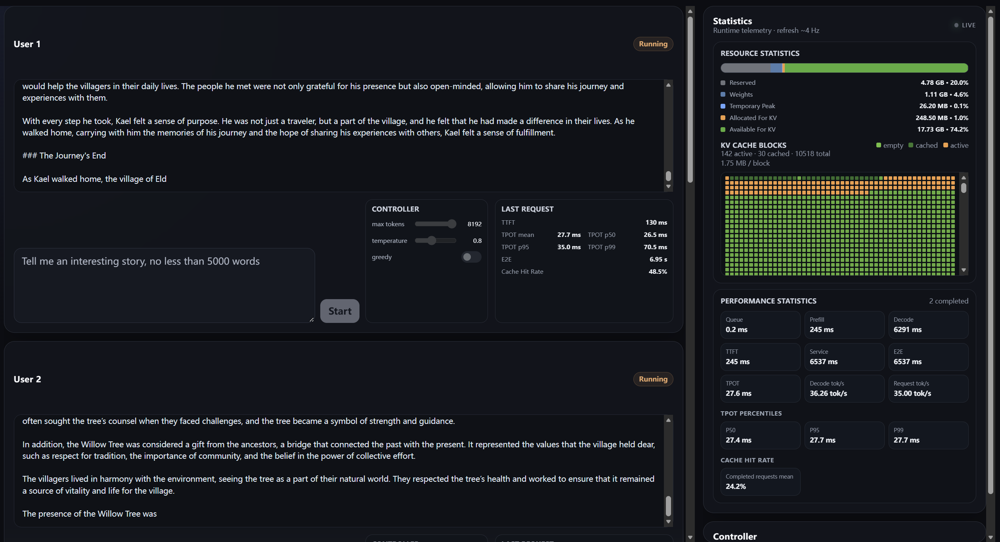

# tinyInfer

A lightweight LLM inference framework built from scratch for learning and experimenting with modern inference-system techniques.

The current implementation supports Qwen3 models and includes:

### KV Cache Management
- Paged KV Cache with LRU replacement policy
- Chunked Prefill + Prefix Cache

### Request Scheduling
- Mixed Batching + Continuous Batching
- Round-Robin Prefill / Decode scheduling

### Attention Backends
- GQA / MQA
- PyTorch SDPA attention backend
- Self-implemented CUDA FlashAttention/FlashDecoding backend

### Inference Optimizations
- Speculative Decoding

### Observability & Web UI
- Runtime performance statistics
- Web-based inference UI

The FlashAttention backend directly supports GQA heads and causal attention with `query_start_pos`, and can be switched at runtime without modifying the model configuration.

## Build

```bash
MAX_JOBS=4 python -m pip install -e . --no-build-isolation
```

## Run with PyTorch SDPA

```bash
TINYINFER_ATTENTION_BACKEND=torch \
python examples/advance07_sd.py \
  --model /path/to/local/target/model \
  [--speculative] \
  [--draft-model /path/to/local/draft/model]
```


## Run with Self-Implemented FlashAttention

```bash
TINYINFER_ATTENTION_BACKEND=flash \
python examples/advance07_sd.py \
  --model /path/to/local/target/model \
  [--speculative] \
  [--draft-model /path/to/local/draft/model]
```


## Web UI

After starting the server, open:

```text
http://127.0.0.1:8000/
```

The UI provides streaming generation together with runtime statistics such as:

- TTFT
- TPOT
- Decode throughput
- End-to-end latency
- KV-cache block states
- KV-cache hit rate
- Ave acceptance length/rate for SD



## Project Goal

tinyInfer is primarily an educational inference framework. Its goal is to expose the core mechanisms behind modern LLM serving systems with a small and readable codebase, rather than hiding them behind large inference libraries.
